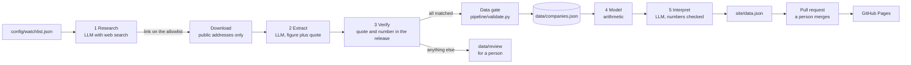

# Luxury Earnings Tracker

Quarterly sales growth of the large luxury groups in one sourced dataset, with a model on top and a website to read it.

Language models find and read the company releases. Fixed rules check their work and do the maths. A person approves every change before it goes live.

## Run it on your computer

You need Python 3.13, the version the checks run on. No API key is needed to view the site or run the model. `requirements.txt` is a locked list with a hash for every package. If it does not install on your system, `pip install -r requirements.in` installs the same direct versions without the hash check.

```bash
python -m pipeline.run serve
```

Then open http://localhost:8000.

To recompute the model and rebuild the site data after a change to `data/companies.json`:

```bash
pip install --require-hashes -r requirements.txt
python -m pipeline.run model
python -m pipeline.run validate
python -m unittest discover -s tests -b
```

## How it works

| Step | File | Who does it | What it does |
|---|---|---|---|
| 1. Research | `pipeline/research.py` | LLM with web search | Finds the newest quarterly release for each company in `config/watchlist.json`. Searches only once a release is due. |
| 2. Extract | `pipeline/extract.py` | LLM | Reads the release and returns each figure with the sentence or table row that states it. |
| 3. Verify | `pipeline/verify.py` | Rules | Checks that every quote and number is in the release. Flags implausible values and conflicts with stored figures. |
| 4. Model | `pipeline/model.py` | Arithmetic | Change against the prior quarter, peer medians, two-year growth, base effects, Asia gap and a rule-based signal. |
| 5. Interpret | `pipeline/interpret.py` | LLM | Writes a short note per company from the model output. A note containing a number that is not in the data is discarded and the rule-based note is kept. |

`pipeline/run.py` ties the steps together and writes `site/data.json`, the one file the website reads.



### The website

Five screens in `site/` (`index.html`, `styles.css`, `app.js`), with no build step and no framework:

- **Overview**: the finding for the quarter, four figures and three exhibits.
- **Compare**: pick companies, a measure and what to compare against (prior quarter, same quarter last year, the median of the others, or one company).
- **Company**: one page per group with its note, trend, segments, regions, base effect and sources.
- **Data and sources**: every figure, whether it comes from the company or from the press, and the evidence behind it.
- **Method**: definitions, signal rules, the pipeline, the quality checks and recent runs.

### What is trusted and what is checked

- The LLM never computes a figure. It finds, quotes and describes.
- A figure is merged automatically only if its quote and its number are both found in the release text. Everything else lands in `data/review/` as a draft.
- The check catches copying errors. It does not prove that a release is genuine. For that reason a release is merged automatically only when its link is on the allowlist: the company's own domain from `config/watchlist.json` or a regulatory wire listed in `pipeline/fetch.py`. Anything else waits for a person.
- Scheduled updates arrive as a pull request. Nothing reaches the live site without a person merging it.

### The checks that run on every change

| Check | Command | What it proves |
|---|---|---|
| Unit, flow and command tests | `python -m unittest discover -s tests -b` | Each step works, a saved release travels from extraction to the file the site reads without touching other companies, and every command behaves as the workflows expect, including when a download is blocked or an answer is cut off. |
| Data gate | `python -m pipeline.run validate` | Every figure has a source, a valid quarter and a plausible value, and the site data matches the dataset. Warns on large swings, a group figure outside its regions, gaps, stale companies and press sources. |
| Browser test | `python tests/smoke_site.py` | All five screens open on desktop and phone widths with no errors, no broken text and the right number of figures. The site loads nothing from another host, and the medians it works out itself agree with the pipeline's. Needs `pip install --require-hashes -r requirements-dev.txt`. |
| Extraction test | `python -m pipeline.run eval` | The LLM re-reads the latest releases and its figures are scored against the verified dataset. Needs an API key. |

The first three run on GitHub for every push and pull request. The site is published only when they pass.

## Commands that use the LLM

These need an Anthropic API key. API usage is billed separately from a Claude subscription.

```bash
pip install --require-hashes -r requirements.txt
export ANTHROPIC_API_KEY=sk-ant-...

python -m pipeline.run update                 # check companies whose release is due, write drafts to data/review
python -m pipeline.run update --apply         # also merge drafts in which every figure matched
python -m pipeline.run add "Burberry" --url https://...   # one company from a known release
python -m pipeline.run add "Burberry" --file release.pdf  # or from a file
python -m pipeline.run apply data/review/burberry-group-2026Q3.json   # merge a draft you have checked
python -m pipeline.run interpret              # rewrite the notes with the LLM
python -m pipeline.run eval                   # measure extraction accuracy against the verified figures
```

### What it costs to run

Hosting and automation on GitHub are free for a public repository. The only running cost is the API.

The pipeline is set up to keep that low:

- Research runs on the cheapest model (`claude-haiku-5-5`) with at most three searches per company.
- A company is searched only once its next release is due. `config/watchlist.json` holds, per company and quarter, how many days after quarter end it reported last time. Use `--force` to search anyway.
- Extraction and the written notes use `claude-sonnet-5-5` and only run when a new release is found.

At list prices this comes to roughly 5 to 8 US dollars a year for six companies, and a little more for each company added, with nothing spent in weeks when no release is due. That figure is an estimate. Every run that calls the API writes its token counts, search count and estimated cost to `data/run_log.json`, and the Method screen shows it.

Each step's model can be changed with `TRACKER_MODEL_RESEARCH`, `TRACKER_MODEL_EXTRACT` and `TRACKER_MODEL_INTERPRET`.

## Put it online with GitHub Pages

1. Create a repository on GitHub and push this folder to the `main` branch.
2. In the repository, open Settings, then Pages, and set Source to "GitHub Actions".
3. The `Test and deploy site` workflow runs on every push to `main` and publishes the `site` folder.

## Automatic updates

The `Update data` workflow runs every Monday and can be started by hand from the Actions tab.

1. Add a repository secret named `ANTHROPIC_API_KEY` (Settings, Secrets and variables, Actions). Create the key in its own workspace with a monthly spend limit.
2. In Settings, Actions, General, allow GitHub Actions to create pull requests.
3. When a new release is found, the workflow opens a pull request with the new figures and the drafts that need review. Merging it redeploys the site.

The `Live check` workflow is run by hand. It searches for one company, scores the extraction step against the verified figures and rewrites the notes, then opens a pull request with the results. Use it once after adding the key, and again after changing a prompt or a model.

## How you hear about problems

Nobody has to remember to look. Three things raise their hand on their own:

| What goes wrong | How you hear | When |
|---|---|---|
| A change would break the data: a figure with no source, an impossible value, site data out of step | The checks on the pull request fail, and GitHub will not publish the site | Before it is merged |
| A release could not be downloaded or read, or the weekly update failed | An issue titled "Weekly update: a release needs a person", assigned to the repository owner | The same Monday |
| A release is overdue, a source link has gone, or a draft is waiting in `data/review` | An issue titled "Data watch: something needs attention", assigned to the repository owner. It closes itself once the problem is gone | The next Monday |

GitHub emails the person an issue is assigned to. To check that this reaches you, run the `Data watch` workflow by hand with "Send a test alert" ticked.

What to do when an alert arrives:

- **Could not fetch** or **refuses automated readers**: download the release yourself and run `python -m pipeline.run add "Company" --file release.pdf`, then review the draft in `data/review`.
- **Draft waiting for review**: open the file, compare each figure marked `part` or `miss` with the release, then `python -m pipeline.run apply data/review/<file> --force`.
- **Overdue**: the company has reported and the tracker has no figure. Usually one of the two cases above.
- **Source link has gone**: find the document's new address and update the link in `data/companies.json`.

What no rule can catch: a figure that is wrong but plausible, or a company restating an old quarter. The quote check at entry and the `Live check` re-read are the protection there, so run `Live check` after each reporting season.

## Use it for another sector

The pipeline knows nothing about luxury except in three places:

1. `config/watchlist.json`: the companies, their investor domains and how long after quarter end they report.
2. `data/companies.json`: the dataset. Start it empty and add companies with `python -m pipeline.run add`.
3. `REGIONS` in `pipeline/common.py` and the wording of the prompts in `pipeline/research.py` and `pipeline/extract.py`.

Change those and the checks, the model and the site work as they are. See [ROADMAP.md](ROADMAP.md) for what is planned and what is deliberately left out, and [SECURITY.md](SECURITY.md) for how the project is protected.

## The data

`data/companies.json` holds one record per company:

- `series`: group growth by calendar quarter (`g`), with revenue (`rev`) and the company's own period label where given. `s` points at an entry in `sources`.
- `regions`: growth by quarter for five buckets (`asia`, `japan`, `europe`, `americas`, `me`), each with the company's own label and a note where the bucket is a loose fit.
- `segments`, `china`, `guidance`, `sources`.

Growth is on the underlying basis each company publishes: organic, constant exchange rates or comparable. Periods are filed under the calendar quarter in which they end. No figure is derived or estimated. See the Method section of the site for the scope differences between companies.

## Status

- The eight companies and eight quarters in the dataset were entered and checked against the linked sources between 15 and 17 November 2026.
- Steps 3 and 4, the data gate and the website are covered by tests and run without a key.
- Three live runs so far, at about 20 cents each. The first found three defects: the answer limit left no room for the model's thinking, a library for protected PDFs was missing, and failures did not say why. All are fixed. In the latest run, on 17 November 2026, research worked, all six notes were written by the model and passed the number check, and extraction matched 18 of 19 verified figures from 4 of 6 releases. The miss was a group figure the model left blank. Two releases could not be downloaded: Moncler's site and the GlobeNewswire wire both refuse automated readers. Those companies' releases go in by hand with `add --file`.
- Every figure cites a company document. LVMH's regional figures come from its slides, which automated tools may not read; they were checked by hand on 17 November 2026. Kering's 2025 quarters use the company's restated figures, which exclude Kering Beauté. Burberry's series is comparable retail sales. For Burberry and Zegna the Asia column is Greater China.

This is a study project built from public company releases. It gives no investment advice.
